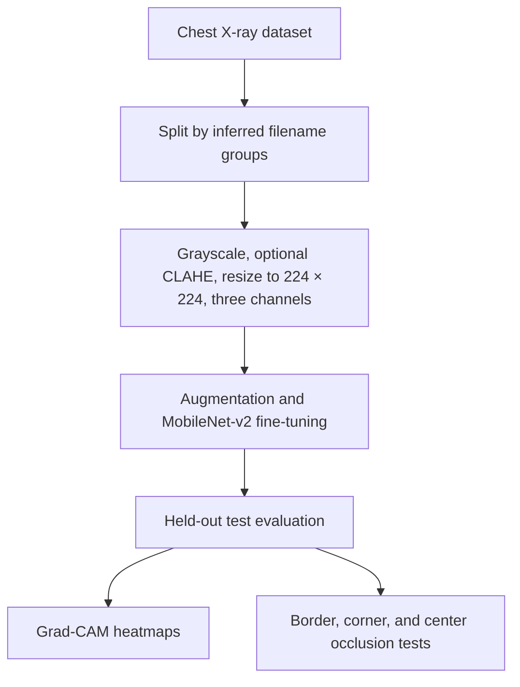

# LungLens

**Explainable chest X-ray classification using MATLAB, MobileNet-v2, and Grad-CAM.**

LungLens classifies chest X-rays as **NORMAL** or **PNEUMONIA** and visualizes regions influencing predictions. It compares CLAHE contrast enhancement against no CLAHE and includes exploratory tests for reliance on image borders and markers.

> Educational research prototype. Not for clinical use.

## Workflow



## Requirements

- MATLAB R2026b
- Deep Learning Toolbox
- Image Processing Toolbox
- Deep Learning Toolbox Model for MobileNet-v2 Network support package

Install missing components through MATLAB’s **Add-Ons** menu.

## Dataset and Setup

Download the pediatric [Chest X-Ray Images (Pneumonia) dataset](https://www.kaggle.com/datasets/paultimothymooney/chest-xray-pneumonia).

Place `chest_xray_project.m` in the project root and the dataset’s original `train`, `val`, and `test` folders inside `data/raw/`.

Example image path:

```text
data/raw/train/NORMAL/IM-0115-0001.jpeg
```

The script merges the original partitions and creates an approximately **70/15/15 split by inferred filename groups**, stratified by class.

| Subset | NORMAL | PNEUMONIA | Total |
|---|---:|---:|---:|
| Training | 1,107 | 3,042 | 4,149 |
| Validation | 236 | 597 | 833 |
| Test | 240 | 634 | 874 |

Filename grouping is approximate; patient independence has not been verified.

## Usage

Set MATLAB’s current folder to the project directory. Run each command separately:

```matlab
chest_xray_project("prepare")   % Save split and preprocessing comparison
chest_xray_project("train")     % Train both preprocessing variants
chest_xray_project("evaluate")  % Generate metrics, plots, and audits
chest_xray_project("explain")   % Select an image and display its heatmap
```

To explain an image using the no-CLAHE model:

```matlab
chest_xray_project("explain", "C:/images/xray.jpeg", "noclahe")
```

Training uses:

- **Optimizer:** Adam
- **Learning rate:** 0.0001
- **Batch size:** 16
- **Maximum epochs:** 8 per model
- **Class weighting:** inverse frequency
- **Augmentation:** rotation, translation, and scaling; no horizontal flips
- **Model selection:** lowest validation loss

Saved models load automatically for evaluation and explanation. Reopening MATLAB does not require retraining, provided the saved model files remain available.

## Test Results

**PNEUMONIA** is the positive class. Results represent one run on the internal test split.

| Model | Accuracy | Sensitivity | Specificity | Precision | F1 | AUC |
|---|---:|---:|---:|---:|---:|---:|
| With CLAHE | 95.54% | 94.48% | 98.33% | 99.34% | 0.96847 | 0.99609 |
| Without CLAHE | 95.31% | 94.80% | 96.67% | 98.69% | 0.96702 | 0.99414 |

CLAHE achieved slightly higher accuracy and specificity; no CLAHE achieved slightly higher sensitivity. These small differences do not establish a reliable advantage.

## Outputs

| Location | Contents |
|---|---|
| `models/` | Saved split and trained networks |
| `results/metrics.csv` | Test metrics for both models |
| `results/clahe/` | CLAHE predictions, plots, heatmaps, and audits |
| `results/noclahe/` | No-CLAHE predictions, plots, heatmaps, and audits |
| `results/latest_explanation.png` | Most recent individual-image explanation |

Dataset and model files are excluded from this repository when using the supplied `.gitignore`. Generate them locally using the setup and training commands.

## Limitations

- The dataset is pediatric; external and clinical validation have not been performed.
- Patient grouping is inferred from filenames and remains unverified.
- Grad-CAM and geometric occlusion tests do not prove clinical reasoning.
- Model scores are not calibrated disease probabilities.
- Manual visual auditing is pending. Re-running `evaluate` overwrites audit CSVs, including manual entries.

## Project Objectives

- Classify chest X-rays using transfer learning.
- Visualize influential regions with Grad-CAM.
- Compare CLAHE preprocessing and investigate possible shortcut features.

## Learning Outcomes

- Apply preprocessing, augmentation, and transfer learning.
- Evaluate performance using sensitivity, specificity, AUC, and classification errors.
- Interpret heatmaps critically and recognize data leakage and validation limitations.

## Why MATLAB?

MATLAB combines image processing, pretrained networks, training visualization, evaluation, and Grad-CAM in one environment, making it practical for developing and inspecting the complete experimental pipeline.
